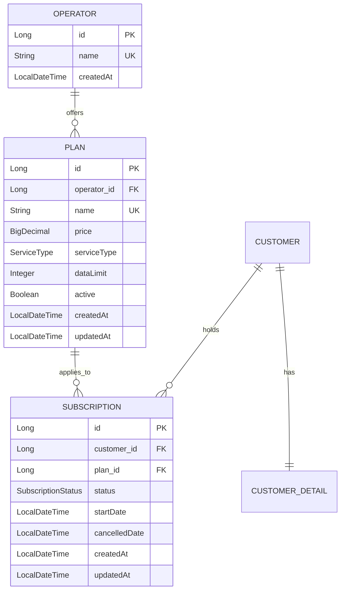

# Subscription Management Platform API

[](https://www.oracle.com/java/)
[](https://spring.io/projects/spring-boot)
[](LICENSE)

A production-ready REST API for multi-operator telecommunications subscription management built with Spring Boot, Spring Data JPA, Spring Security (JWT), MySQL, and Redis.

---

## Architecture & Features

- **Multi-Tenant Operators & Plans**: Catalog of Internet (Fiber) and Mobile plans per telecom operator.
- **Business Invariant Enforcement**:
  - Maximum of **one active subscription per service type** (`INTERNET`, `MOBILE`) per customer.
  - Plan changes restricted to the **same operator and service type**.
  - Cancellation auditing with immutable timestamp preservation.
- **Security & Token Blacklisting**: Stateless JWT authentication with Redis-backed token invalidation on logout.
- **Auditing & Clean Architecture**: Entity audit timestamps (`createdAt`, `updatedAt`), DTO/Entity decoupling with MapStruct, centralized `@RestControllerAdvice` error handling.
- **Automated Seeding**: Default accounts (`ADMIN`, `USER`), telecom operators (Telia, Tele2), and active/inactive plans loaded on startup.

---

## Tech Stack

| Component | Technology |
| :--- | :--- |
| **Language & Runtime** | Java 25 |
| **Framework** | Spring Boot 4.0.3 |
| **Persistence** | Spring Data JPA (Hibernate), MySQL 8.0 |
| **Caching & Invalidation** | Redis (Docker) |
| **Security** | Spring Security 6 (Stateless JWT + JJWT) |
| **Object Mapping** | MapStruct 1.6.3 |
| **Documentation** | SpringDoc OpenAPI 3 / Swagger UI |
| **Build & Containerization** | Maven, Docker Compose |

---

## Domain Model



---

## Getting Started

### 1. Prerequisites
- [JDK 25](https://www.oracle.com/java/technologies/downloads/)
- [Docker Desktop](https://www.docker.com/products/docker-desktop/)

### 2. Infrastructure Setup
Start the MySQL database (port `3307`) and Redis cache (port `6379`):

```bash
docker-compose up -d
```

### 3. Run the Application
Navigate to the API module and run the Spring Boot service:

```bash
cd subscription-api
./mvnw spring-boot:run
```

---

## API Endpoints

### Authentication (`/api/v1/auth`)
| Method | Endpoint | Access | Description |
| :--- | :--- | :--- | :--- |
| `POST` | `/api/v1/auth/login` | Public | Authenticates and returns JWT token |
| `POST` | `/api/v1/auth/logout` | Authenticated | Blacklists JWT in Redis |

### Operators (`/api/v1/operators`)
| Method | Endpoint | Access | Description |
| :--- | :--- | :--- | :--- |
| `POST` | `/api/v1/operators` | `ADMIN` | Create new operator |
| `GET` | `/api/v1/operators` | `USER`, `ADMIN` | List all operators |
| `GET` | `/api/v1/operators/{id}` | `USER`, `ADMIN` | Get operator by ID |

### Plans (`/api/v1/plans`)
| Method | Endpoint | Access | Description |
| :--- | :--- | :--- | :--- |
| `POST` | `/api/v1/plans` | `ADMIN` | Create a new plan |
| `PUT` | `/api/v1/plans/{id}` | `ADMIN` | Update plan details |
| `DELETE` | `/api/v1/plans/{id}` | `ADMIN` | Delete a plan |
| `GET` | `/api/v1/plans` | `ADMIN` | View all plans (active & inactive) |
| `GET` | `/api/v1/plans/active` | `USER`, `ADMIN` | View all active plans |
| `GET` | `/api/v1/plans/active/type/{type}` | `USER`, `ADMIN` | Filter active plans by `INTERNET` or `MOBILE` |
| `GET` | `/api/v1/plans/active/operator/{id}`| `USER`, `ADMIN` | Filter active plans by operator |

### Subscriptions (`/api/v1/subscriptions`)
| Method | Endpoint | Access | Description |
| :--- | :--- | :--- | :--- |
| `POST` | `/api/v1/subscriptions` | `USER` | Subscribe to an active plan |
| `GET` | `/api/v1/subscriptions/my` | `USER` | View authenticated user's subscriptions |
| `PUT` | `/api/v1/subscriptions/{id}/change`| `USER` | Change plan within same operator & service type |
| `PUT` | `/api/v1/subscriptions/{id}/cancel`| `USER` | Cancel an active subscription |
| `GET` | `/api/v1/subscriptions` | `ADMIN` | List all subscriptions in the platform |

---

## Interactive API Documentation

Once the application is running, OpenAPI / Swagger documentation is available at:
- **Swagger UI:** [http://localhost:8080/swagger-ui.html](http://localhost:8080/swagger-ui.html)
- **OpenAPI JSON:** [http://localhost:8080/v3/api-docs](http://localhost:8080/v3/api-docs)

---

## Seed Accounts for Testing

| Role | Email | Password | Permissions |
| :--- | :--- | :--- | :--- |
| **Admin** | `admin@example.com` | `password` | Operator & Plan Management, Global Audits |
| **Customer** | `user@example.com` | `password` | Browsing plans, Managing own subscriptions |

---

## Running Automated Tests

Execute unit and integration tests across all layers:

```bash
cd subscription-api
./mvnw clean test
```
